# 100 models for time series prediction! Pytorch framework, switch at any line!

What is the project for this period? A brief summary: A Python framework that integrates 100 time series prediction models, covering mainstream methods from traditional machine learning to the latest deep learning. The models are mainly built using Pytorch framework, and can be switched between models with just one modification of a variable, automatically completing the entire process of training, prediction, evaluation, plotting, and probability prediction. Additionally, it allows for a one-click switch between four case tasks:
Case 1 — Single feature input + single step prediction
Case 2 — Single feature input + multiple steps prediction
Case 3 — Multiple features input + single step prediction
Case 4 — Multiple features input + multiple steps prediction
flag = 'LSTM'  # Change this to use which model you want
# Modify here to change to 'Transformer', 'XGBOOST', 'Mamba', or any other 97 models, just run it.
Supports 100 models, I have summarized and classified them as follows:
\n        \n      \n        \n      From the most basicLSTM, To2024Yearly summitTimesNet, PatchTST, Mamba, Back to the traditionalXGBoost, Random Forest, all included.。  
Supports which prediction tasks four types of task examples, for the load prediction task all 100 models are universal:
\n        \n      The switching method is very simple, just need to modify three parameters: nin (input window length), nout (predicting step), valuess (which columns are taken as input features). The code provides complete configuration examples for four cases, which can be directly copied.
1. Overview of core functionality: 1. Switching models with a single click by modifying the flag variable. All models share the same set of data processing. Training Evaluation, Drawing process, No changes are needed to any other code.
flag = 'SegRNN'     # Switch the model name here.epochs = 80              # Number of training rounds (effective for deep learning models), sklearn The model ignores this parameter.)batch_size = 8           # Mini-batch Sizelearning_rate = 1e-4     # Learning ratefit_or_not = 1           # 1=Retrain and save the model, 0=Load the saved model and directly predict.\n2. The code for changing model parameters with a single click can conveniently change each model parameter, and the interface is already written in the main function:
def many_model(flag, fit_or_not, epochs, batch, learning_rate,\n               vp_train, vp_val, vp_test, vt_train, vt_val, vt_test,\n               m_out, n_out, n_in, or_dim, task_tag=""):\n    """\n    According to flag Select the corresponding model and perform training./Prediction。\n\n\n    If you need to adjust the hyperparameters of a certain model, please refer to the corresponding section below. elif Modify directly in the branch.。\n\n\n    Parameters\n    ----------\n    flag : str          Model Name Identifier\n    fit_or_not : int    1=Retrain and save the model, 0=Load the saved model and directly predict.\n    epochs : int        Training rounds (valid only for deep learning))\n    batch : int         Mini-batch Size\n    learning_rate : float  Learning rate\n    vp_train/vp_val/vp_test : ndarray  Normalized input features (training)/Verification/Test)\n    vt_train/vt_val/vt_test : ndarray  Normalized target values (training)/Verification/Test)\n    m_out : MinMaxScaler  Output inverse normalizer\n    n_out : int         Predicted stride\n    n_in : int          Input time window length\n    or_dim : int        Input feature dimension\n    task_tag : str      Task type label for result folder naming\n\n\n    Returns\n    -------\n    model_obj : modelss             Model management object (including) predict_interval Waiting methods)\n    xunlian_predicted_data : ndarray  Training set prediction results (normalized back))\n    ceshi_predicted_data : ndarray    Test set prediction results (normalized back))\n    """\n    model_obj = modelss(fit_or_not, True, epochs, batch, learning_rate,\n                        vp_train, vp_val, vp_test, vt_train, vt_val, vt_test,\n                        m_out, n_out, n_in, or_dim, task_tag=task_tag)\n\n\n    xunlian_predicted_data = []\n    ceshi_predicted_data = []\n\n    # ======================== Basic RNN / LSTM / GRU ========================\n    if flag == 'LSTM':\n        dro, LSTM_units = 0.2, 128\n        xunlian_predicted_data, ceshi_predicted_data = model_obj.run_LSTM(dro, LSTM_units)\n    elif flag == 'CNN_SE_BiLSTM':\n        filters, kernel_size, hidden_size, dro = 64, 3, 128, 0.2\n        xunlian_predicted_data, ceshi_predicted_data = model_obj.run_CNN_SE_BiLSTM(filters, kernel_size, hidden_size, dro)\n    elif flag == 'ECA_CNN_Transformer':\n        filters, kernel_size, d_model, nhead, num_layers, dro = 64, 3, 64, 4, 2, 0.2\n        xunlian_predicted_data, ceshi_predicted_data = model_obj.run_ECA_CNN_Transformer(filters, kernel_size, d_model, nhead, num_layers, dro)\n    elif flag == 'BiGRU_Attention_CNN':\n        gru_hidden, nhead, filters, kernel_size, dro = 64, 4, 64, 3, 0.2\n        xunlian_predicted_data, ceshi_predicted_data = model_obj.run_BiGRU_Attention_CNN(gru_hidden, nhead, filters, kernel_size, dro)\n    elif flag == 'WaveNet_LSTM':\n        wave_channels, num_wave_layers, lstm_hidden, dro = 64, 4, 64, 0.2\n        xunlian_predicted_data, ceshi_predicted_data = model_obj.run_WaveNet_LSTM(wave_channels, num_wave_layers, lstm_hidden, dro)\n\n    # ======================== Mamba / SSM Series ========================\n    elif flag == 'Mamba':\n        d_model, d_conv, num_layers, dro = 64, 4, 2, 0.2\n        xunlian_predicted_data, ceshi_predicted_data = model_obj.run_Mamba(d_model, d_conv, num_layers, dro)\n    elif flag == 'Mamba_LSTM':\n        d_model, d_conv, num_mamba_layers, lstm_hidden, dro = 64, 4, 2, 64, 0.2\n        xunlian_predicted_data, ceshi_predicted_data = model_obj.run_Mamba_LSTM(d_model, d_conv, num_mamba_layers, lstm_hidden, dro)\n    elif flag == 'Mamba_Attention':\n        d_model, d_conv, num_mamba_layers, nhead, dro = 64, 4, 2, 4, 0.2\n        xunlian_predicted_data, ceshi_predicted_data = model_obj.run_Mamba_Attention(d_model, d_conv, num_mamba_layers, nhead, dro)\n    elif flag == 'Mamba_Transformer':\n        d_model, d_conv, num_mamba_layers, nhead, num_tf_layers, dro = 64, 4, 2, 4, 2, 0.2\n        xunlian_predicted_data, ceshi_predicted_data = model_obj.run_Mamba_Transformer(d_model, d_conv, num_mamba_layers, nhead, num_tf_layers, dro)\n    elif flag == 'BiLSTM_Mamba':\n        lstm_hidden, d_model, d_conv, num_mamba_layers, dro = 64, 64, 4, 2, 0.2\n        xunlian_predicted_data, ceshi_predicted_data = model_obj.run_BiLSTM_Mamba(lstm_hidden, d_model, d_conv, num_mamba_layers, dro)\n\n\n    # ======================== SCINet ========================\n    elif flag == 'SCINet':\n        d_model, num_levels, kernel_size, dro = 64, 2, 3, 0.2\n        xunlian_predicted_data, ceshi_predicted_data = model_obj.run_SCINet(d_model, num_levels, kernel_size, dro)\n     elif flag == 'MultiHead_LSTM':\n         .......\n\n\n\n    else:\n        raise ValueError(f"Unknown model name: '{flag}', Please check the spelling is correct.。")\n\n\n    return model_obj, xunlian_predicted_data, ceshi_predicted_data\n3. Data segmentation to prevent data leakage  
Data is segmented into training set, validation set, and test set in chronological order, with gaps (gap = input window + prediction step - 1) inserted between adjacent segments to ensure that no samples are constructed from any segment overlap with the original data. The normalizer (MinMaxScaler) only fits on the training set, while the validation set and test set undergo transformation only.
4. During training, a deep learning model uses an independent validation set to monitor performance, combined with an early stopping mechanism to prevent overfitting. After training, the model automatically reverts to the best-performing weights on the validation set.
5. Probability interval prediction supports not only point predictions but also probability interval predictions, providing confidence intervals for predictions:
For deep learning models with Dropout: Automatically uses the MC Dropout method
For models without Dropout and traditional machine learning: Automatically uses the residual Bootstrap method
No modifications to model structure are required; the calculation is done automatically after training, supporting custom confidence levels (90%, 95%, 99% etc.).
## ===Step 5: Probability interval prediction (optional))===\nuse_interval = 1         # 1=Open probability interval prediction, 0=Perform only point prediction\nconfidence_level = 0.90  # Confidence level: 0.90(90%), 0.95(95%), 0.99(99%)\nmc_samples = 100         # MC Dropout Number of samples (the larger the better, recommended) 50~200)\n# Interval forecasting method description: \n# - Contain Dropout Layer-wise deep learning models: automatically used MC Dropout Method\n# - Not include Dropout Layer-wise deep learning models and traditional machine learning models: automatically using residuals. Bootstrap Method\n# - Both methods do not require modification of the model structure, and the training is automatically calculated after completion.\n  
6. SCI-level plots are automatically generated into three types of charts, which can be directly used in papers:
Prediction comparison graph: true values vs. predicted values with error filled areas and indicator labels
Scatter plot: correlation between predicted values and true values, including a fitting line and R²
Residual analysis graph: residual bar chart + error distribution histogram (including a normal fitting curve)
Interval prediction graph (when probability prediction is enabled): predicted values + confidence interval band
All charts are saved as PNG (300dpi) and PDF (600dpi) vector formats simultaneously.
Prediction image display segment:
\n        \n      \n        \n      \n        \n      \n        \n      \n        \n      \n        \n      \n        \n      In summary, any model can support four tasks (single-feature input). + Stepwise prediction, single feature input + Multi-step prediction, multi-feature input + Stepwise prediction, multi-feature input + Multi-step prediction) and the corresponding analysis chart。  
6. Complete evaluation indicators are automatically calculated and printed: MSE, RMSE, MAE, MAPE, R², additionally, interval prediction outputs additional indicators such as PICP, PINAW.
\n        \n      Project Structure├── MAIN.py    # Main entry file, where data is configured, models are selected, and parameters are adjusted.\n├── model.py                       # Model management class, 100Training of a model/Predictive logic\n├── Shared_def.py                  # Data partitioning, evaluation metrics, plotting functions\n├── Handwritten_network/           # Model implementation\n│   ├── new_models.py              # 49A new additionPyTorchModel architecture\n│   ├── pytorch_models.py          # BasicPyTorchModel (RNN/CNN/TCNWaiting)\n│   ├── Transformer.py             # TransformerImplementation\n│   ├── ekan.py                    # KANSeries model\n│   ├── defothermodels.py          # TensorFlowModel training entry\n│   └── tfts/                      # TensorFlowTemporal model library\n├── Power load forecasting data1.csv           # Example data\n├── Power load forecasting data2.csv           # Example data\n├── Electricity price forecast.csv           # Example data\n├── Wind farm power prediction.csv           # Example data\n├── Bangladesh weather time series data.csv           # Example data\n├── Save_models/                   # The trained model is automatically saved here.\n└── Prediction result saving/                   # Prediction results and charts are automatically saved here.\nThe project code is simple and easy to understand, making it very suitable for beginners! How to use? First step: prepare your data. (CSVOrExcel), Ensure that the target columns (load, power, wind speed, temperature, electricity price, etc.) are placed in the last column.。  
Step 2: Open MAIN.py, modify the data reading path and task configuration (n_in, n_out, valuess).
Step 3: Change flag to the model name you want to use.
Step 4: Run.
Fully automatic workflow: Training log → Evaluation metrics table → Prediction graph/scatter plot/residual plot → All saved automatically.
Want to compare with another model? Just change the flag and run again.
Environment-dependent on Python 3.9+
PyTorch (for most models)
TensorFlow (only for Seq2Seq/WaveNet/BERT/Informer)
scikit-learn, XGBoost (traditional machine learning models) LightGBM, CatBoost (optional, install as needed)
NumPy, Pandas, Matplotlib, PrettyTable
The core value of this framework lies in uniformity and convenience - 100 models can run under the same set of specifications, data processing methods are consistent, evaluation standards are consistent, output formats are consistent. Whether you want to quickly verify the effect of a model on your data or want to batch run multiple models for cross-comparison, changing a variable name is all that's required.
If you are engaged in research or projects related to time series prediction, this tool hopes to help you save a lot of time spent re-inventing the wheel.

## Images

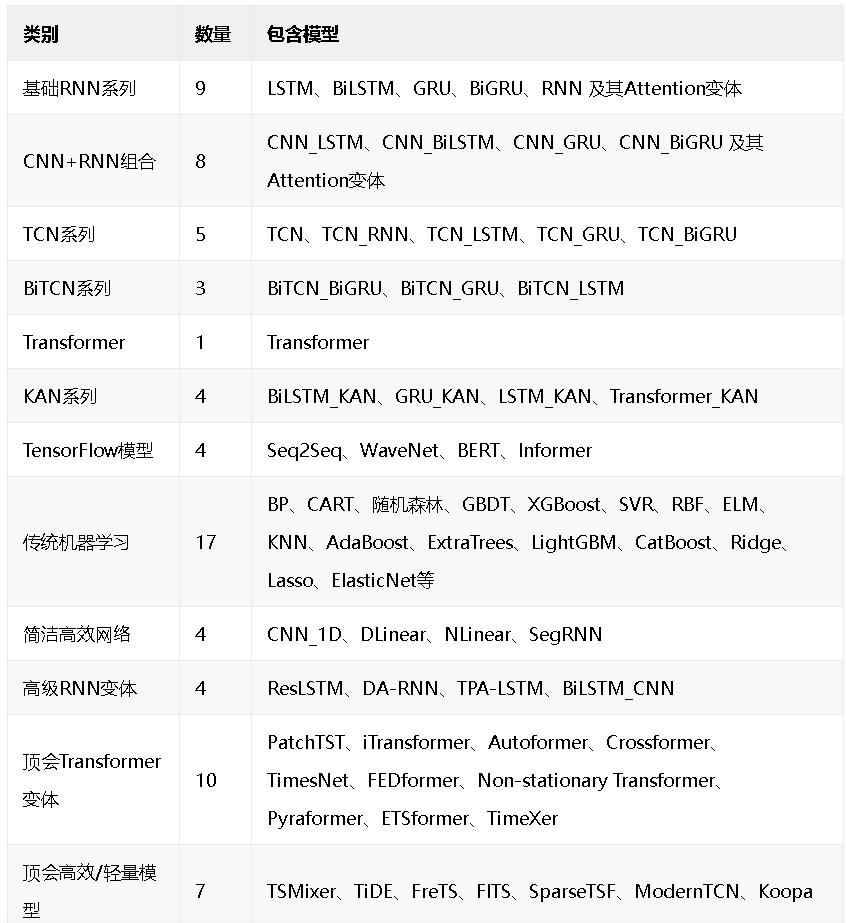
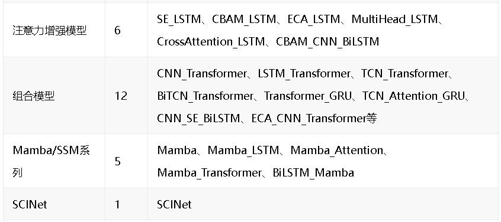
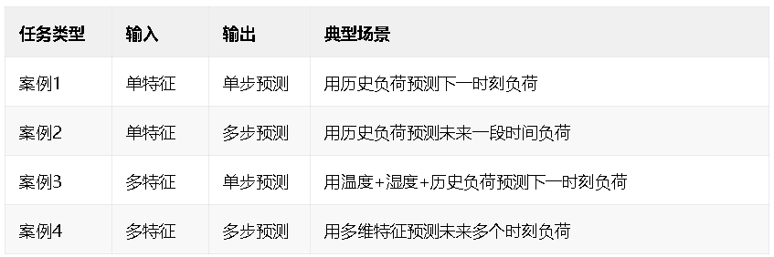
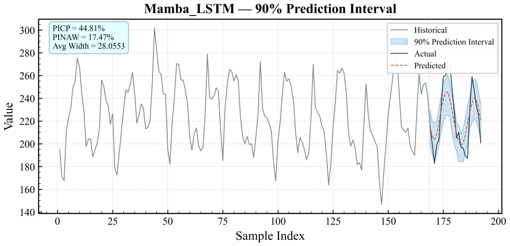
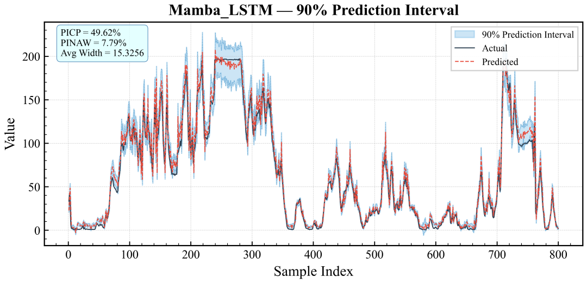
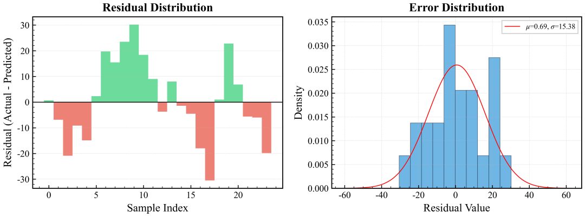
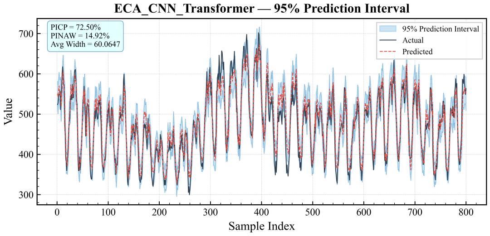
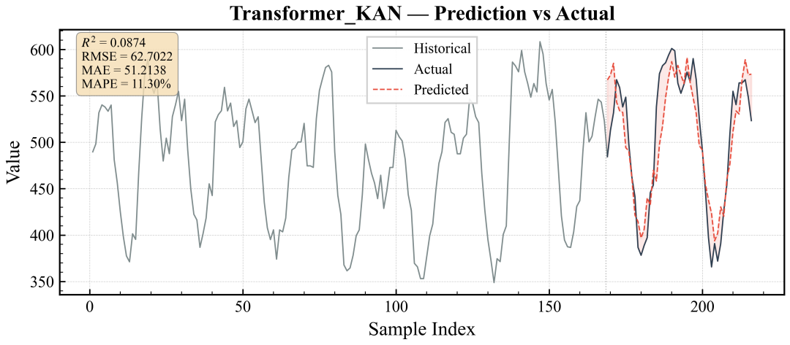
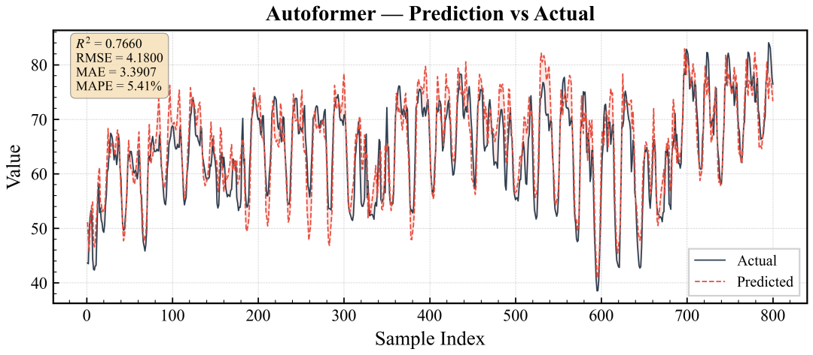
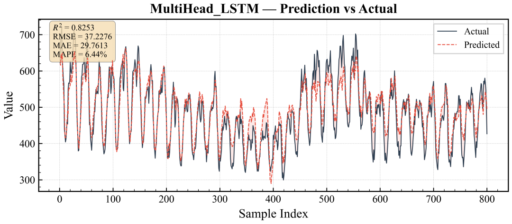
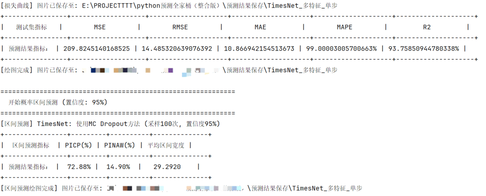

<!-- PAYMENT_BLOCK -->

## Get this dataset

- Payment link (Stripe): [Buy now](https://buy.stripe.com/3cs8yP7sY87d0vu9AB)
- Payment QR code: 

<!-- /PAYMENT_BLOCK -->
